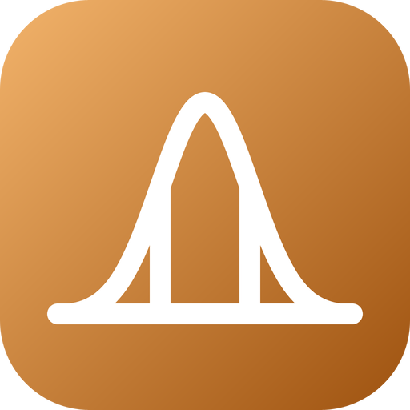

# go-statistics — brand assets

Official logos for the **go-statistics** organization.



The mark is a normal density over its axis, with the two lines at one
standard deviation either side of the mean that bound its central 68 %. The
curve is computed, not drawn: `mark/main.go` samples the density at every half
standard deviation and joins the samples with cubic Bézier segments taken from
its exact derivative. Its gradient (`#F2B36B` to `#9E520F`) is an amber that
sets go-statistics apart from the emerald of go-ndarray, go-fft and
go-notebook, from go-plot's blue, from go-numerics' violet and from
go-dataframe's magenta; its dark end reads on white at 5.73:1 and its light
end on a dark page at 10.52:1.

## Formats

- **SVG** — `svg/color`, `svg/white` (white, transparent), `svg/black` (black, transparent)
- **PNG** 16→1024 px, 3 variants — `png/<variant>/<size>/`
- **JPG** (color, white background) — `jpg/<size>/`
- **ICO** (Windows) — `ico/`
- **ICNS** (macOS) — `icns/`
- **GitHub avatar** 512 px — `avatar/`
- **Social preview** 1280×640 (repo banner) — `social/`

`check/kit.py` counts the whole matrix on every pull request, and the `mark`
job writes `svg/color/go-statistics.svg` again from `mark/main.go` and fails if
a byte differs.

```sh
cd mark && go run . > ../svg/color/go-statistics.svg
```

---
*`svg/color/go-statistics.svg` is written by `mark/main.go`; every other file is
generated from it by the fleet's Go brand pipeline (brandgen) — rounded square
badge, line glyph, color / white / black variants.*
